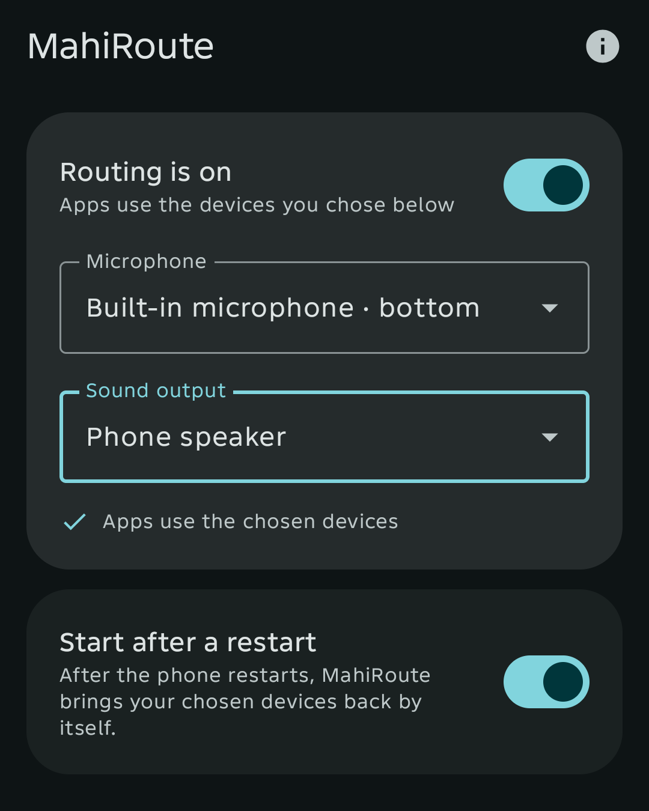
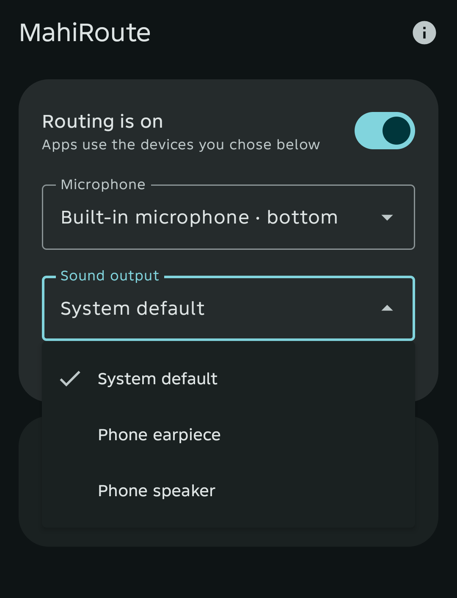
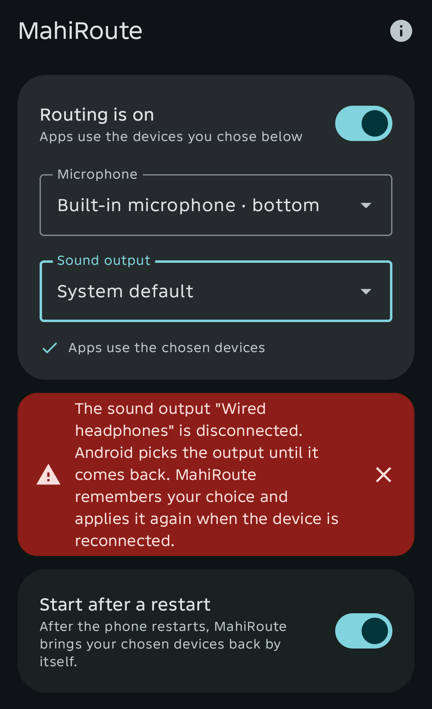
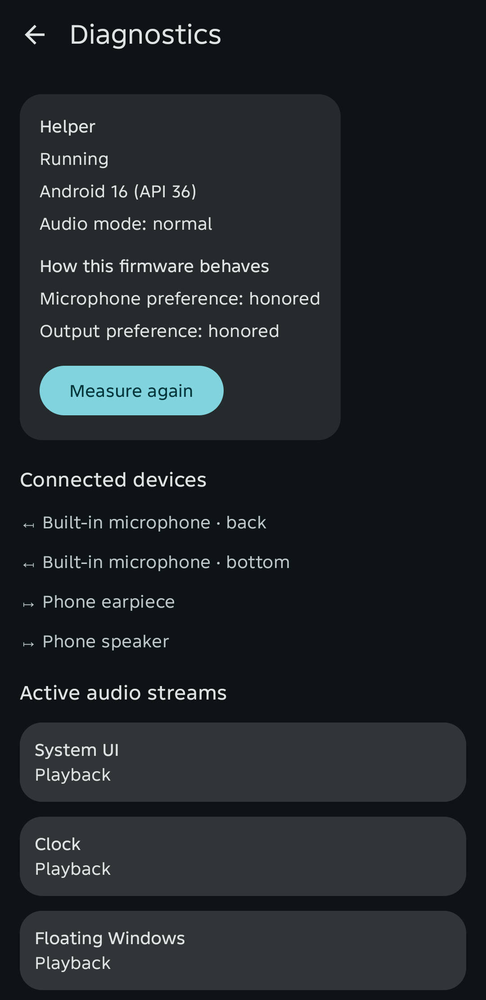
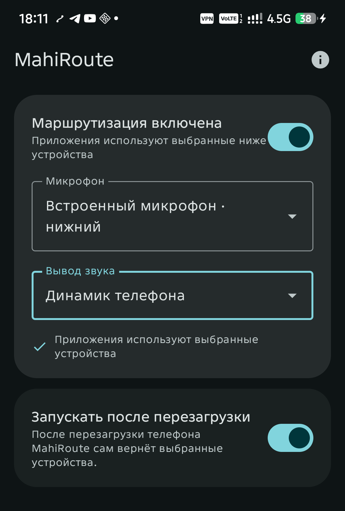
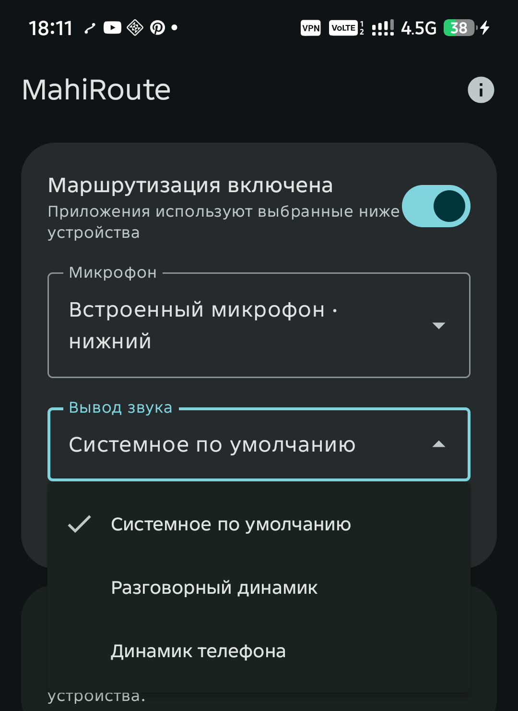
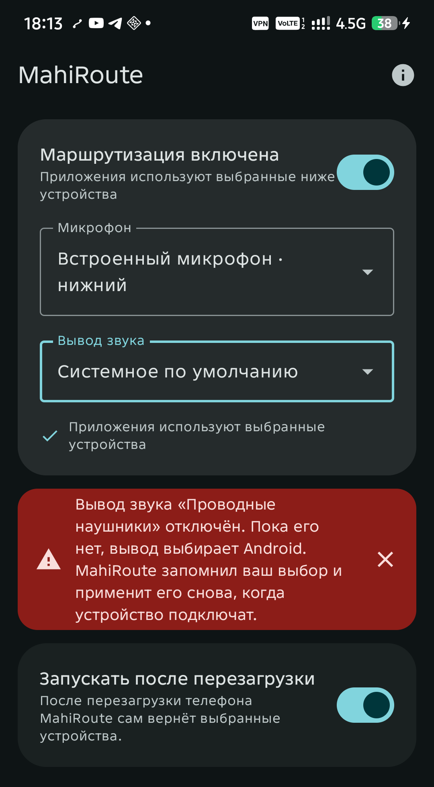
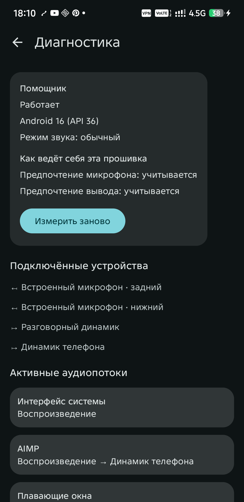

<div align="center">

# MahiRoute

**Choose the microphone and the sound output that every app on your Android phone uses**
<br>
**Выберите микрофон и вывод звука, которые используют все приложения вашего Android-телефона**

[](https://github.com/Mahiron-hq/MahiRoute/actions/workflows/ci.yml)
[](https://github.com/Mahiron-hq/MahiRoute/releases/latest)
[](LICENSE)
[-3ddc84)](#install)
[](rust/Cargo.toml)
[](gradle/libs.versions.toml)

**[English](#english)** · **[Русский](#русский)**

</div>

---

<a id="english"></a>

## 🇬🇧 English

Plug in headphones without a microphone and Android silently moves your recording to the
headset's (non-existent) microphone: voice messages and calls go quiet. MahiRoute lets you
decide instead. Pick the built-in microphone, a USB or Bluetooth device, and any speaker or
headphones, and every app (Telegram, Discord, a voice recorder, anything) follows your choice.

No root, no virtual machines, no cloned apps: your own apps keep their accounts, data and
notifications. A tiny helper started through Android's own wireless debugging changes the
system audio routing, and MahiRoute checks with real test streams that Android obeyed.

<div align="center">

<table>
  <tr>
    <td></td>
    <td></td>
    <td></td>
    <td></td>
  </tr>
</table>

</div>

### Features

- **System-wide choice** of the microphone and of the sound output, for every app, live: the lists follow devices as they are plugged in and out.
- **Verified, not assumed.** After applying a choice MahiRoute opens short test streams and shows "Apps use the chosen devices" only when Android really routed them there.
- **Works around firmware that ignores preferences.** Where a phone ignores the preferred-device API (measured on MIUI), MahiRoute hides the devices that would win, such as the headset microphone, and restores them afterwards.
- **Unplugging is handled.** While the chosen device is gone, the field shows "System default" and the warning names the device. MahiRoute remembers your choice and applies it again when the device comes back. Close the warning with the cross and it stays closed, even after a restart; choosing another device forgets the old one.
- **Quick Settings tile and notification switch** to turn routing on and off.
- **Diagnostics screen:** helper state, Android version, how the firmware behaves, connected devices (including hidden ones) and the apps that play or record sound right now.
- **Starts itself.** The helper starts through wireless debugging and comes back after a reboot. A switch lets you turn the start after a restart off.
- **Phones without Wi-Fi.** A Windows launcher (`MahiRoute-start.bat`) starts the helper over USB: double-click, press Enter.
- **Private.** No ads, no analytics, no accounts, nothing leaves your phone. English and Russian interface. Free software under the AGPL.

### Install

Requirements: Android 12 (API 31) or newer on an arm64 phone. Verified on Android 13 (MIUI 14) and Android 16; the playback check needs Android 13.

1. Download `MahiRoute-1.0.0.apk` and `SHA256SUMS.txt` from the [latest release](https://github.com/Mahiron-hq/MahiRoute/releases/latest) and compare the checksum: `sha256sum -c SHA256SUMS.txt`.
2. Install the APK (allow installs from your browser or file manager when Android asks).
3. Open MahiRoute and allow notifications, Bluetooth and the battery exemption when asked.

#### Start the helper (once per boot)

Android only lets the system choose audio devices, so MahiRoute starts a small helper with debugging rights. It needs a **Wi-Fi connection, but that network does not need internet access**: any router or another phone's hotspot works, even without a route to the internet.

1. Pick your devices and tap **Start the helper**.
2. Turn on **Developer options → Wireless debugging**. The first time, pair MahiRoute: open **Pair device with pairing code** and type the six digits into the MahiRoute notification (leave the Android dialog open) or into the field on the card.
3. If Android asks **"Allow wireless debugging on this network?"**, tap OK. MahiRoute waits for your answer (up to two minutes) and carries on by itself; no second tap on the start button is needed.
4. Done. The app now switches wireless debugging on by itself and restarts the helper after a reboot as soon as Wi-Fi is available.

On MIUI / HyperOS also allow autostart for MahiRoute (Security → Permissions → Autostart); otherwise open the app once after a reboot.

#### Phones without Wi-Fi

If the phone cannot join Wi-Fi (for example it shares its own connection), start the helper from a computer: on the helper card open **Start from a computer**, tap **Save the Windows file** (it lands in Downloads as `MahiRoute-start.bat`), copy it to the PC and double-click it while the phone is connected by USB with USB debugging on. It finds `adb`, waits for the phone, shows the command and asks you to press Enter. MahiRoute connects to the helper by itself. Without Windows run `adb shell sh /storage/emulated/0/Android/data/io.github.mahiron_hq.mahiroute/files/start-helper.sh`.

### How it works

```
 MahiRoute app (Kotlin, Compose)
   │ JNI
 Engine (Rust): state machine, routing planner, verification, ADB client
   │ loopback TCP + token, JSON lines
 Helper (Java, shell uid, started with app_process)
   │ AudioManager / AudioSystem
 Android audio policy ──► chosen microphone and output
```

The Rust engine decides what to apply (a preferred device per capture preset and product strategy, plus devices to hide), the helper applies it with shell rights, and test streams confirm the result. Details are in [docs/ARCHITECTURE.md](docs/ARCHITECTURE.md); measurements on real phones and the reasons a PC or Wi-Fi is still needed are in [docs/FINDINGS.md](docs/FINDINGS.md).

### Limitations

- Routing is system-wide, not per app.
- Without root the helper can only be started through wireless debugging (needs Wi-Fi) or from a computer over USB, and again after every reboot of the phone.
- A wired headset that has no microphone cannot record: choosing it as the microphone gives silence.
- While the firmware ignores preferences, choosing one built-in microphone hides the other.
- Checking playback routing needs Android 13; on Android 12 routing is applied but reported as "applied, check not completed".
- Bluetooth devices and USB DACs are not covered by the test devices below.
- The app deliberately does not clone or virtualize other apps.

### Verified on

| Check | Redmi Note 10S, Android 13 (MIUI 14) | Infinix X6855, Android 16 |
|---|---|---|
| Recording follows the chosen microphone | yes | yes |
| Voice recorder uses the built-in microphone while headphones are plugged in | yes | not applicable (no jack) |
| Call mode keeps the chosen microphone and output; real calls | yes | yes, including real calls (checked by the maintainer) |
| Playback follows the chosen output (media and call) | yes | yes |
| Firmware behavior | capture preference ignored, hiding works | preferences honored |
| Helper starts from the phone through wireless debugging | yes | not testable (the phone shares its connection) |
| Helper started from a PC by `MahiRoute-start.bat`, app connects by itself | yes | yes |
| Helper returns by itself after a reboot, routing verified | yes | yes (checked by the maintainer) |
| "Start after a restart" off: nothing runs after a reboot | yes | yes (checked by the maintainer) |
| Unplug and replug of the chosen device (warning, close, restart, restore) | yes (protocol-level simulation) | warning and fallback to the system default (simulation) |

### Build

Requirements: JDK 17, the Android SDK (platform 36, build-tools 36.1.0, NDK 29), Rust 1.95 with the `aarch64-linux-android` target, [`cargo-ndk`](https://github.com/bbqsrc/cargo-ndk) 4.1.2 and CMake (BoringSSL is built from source).

```
export ANDROID_NDK_HOME=$ANDROID_HOME/ndk/29.0.14206865
./gradlew :app:testDebugUnitTest :app:lintDebug :app:assembleDebug     # builds the Rust library too
./gradlew :app:assembleRelease                                         # debug-signed unless signing is configured

cd rust
cargo fmt --check && cargo clippy --all-targets --all-features -- -D warnings
cargo build --all-targets && cargo test --all-features
```

Release signing is read from the Gradle properties `RELEASE_STORE_FILE`, `RELEASE_STORE_PASSWORD`, `RELEASE_KEY_ALIAS` and `RELEASE_KEY_PASSWORD`. The layout of the repository is described in [docs/ARCHITECTURE.md](docs/ARCHITECTURE.md). The JSON that Rust sends to the Kotlin UI is pinned by a golden file; after an intended change regenerate it with `UPDATE_GOLDEN=1 cargo test -p mahiroute-engine --test ui_contract`.

### Privacy and security

MahiRoute collects nothing and sends nothing anywhere; see [PRIVACY.md](PRIVACY.md). Report vulnerabilities privately as described in [SECURITY.md](SECURITY.md). Contributions are welcome: see [CONTRIBUTING.md](CONTRIBUTING.md).

### License

MahiRoute is free software under the **GNU Affero General Public License, version 3 or (at your option) any later version**: see [LICENSE](LICENSE). Third-party components and their licenses are listed in [NOTICE](NOTICE) and [legal/](legal/).

Copyright © 2026 Lev Burmistrov (Mahiron-hq)

---

<a id="русский"></a>

## 🇷🇺 Русский

Подключили наушники без микрофона, и Android молча переключил запись на несуществующий микрофон гарнитуры: голосовые сообщения и звонки стали тихими. MahiRoute даёт выбрать самому: встроенный микрофон, USB- или Bluetooth-устройство, любой динамик или наушники, и все приложения (Telegram, Discord, диктофон, любые другие) следуют вашему выбору.

Без root, без виртуальных машин и клонов: ваши приложения остаются со своими аккаунтами, данными и уведомлениями. Небольшой помощник, запущенный через штатную отладку Android по Wi-Fi, меняет системную маршрутизацию звука, а MahiRoute проверяет настоящими тестовыми потоками, что Android подчинился.

<div align="center">

<table>
  <tr>
    <td></td>
    <td></td>
    <td></td>
    <td></td>
  </tr>
</table>

</div>

### Возможности

- **Системный выбор** микрофона и вывода звука для всех приложений, в реальном времени: списки следят за подключением и отключением устройств.
- **Проверка, а не вера.** После применения выбора запускаются короткие тестовые потоки, и «Приложения используют выбранные устройства» появляется, только если Android действительно направил звук туда.
- **Обход прошивок, которые игнорируют предпочтения.** Где телефон игнорирует предпочтительное устройство (замерено на MIUI), MahiRoute скрывает устройства, которые победили бы, например микрофон гарнитуры, и возвращает их потом.
- **Отключение устройства.** Пока выбранного устройства нет, поле показывает «Системное по умолчанию», а предупреждение называет устройство. MahiRoute помнит ваш выбор и применяет его снова, когда устройство вернётся. Закройте предупреждение крестиком, и оно не вернётся даже после перезапуска; выбор другого устройства забывает прежнее.
- **Плитка быстрых настроек и переключатель в уведомлении.**
- **Диагностика:** состояние помощника, версия Android, поведение прошивки, подключённые устройства (в том числе скрытые) и приложения, которые сейчас играют или пишут звук.
- **Запускается само.** Помощник стартует через отладку по Wi-Fi и возвращается после перезагрузки. Переключатель позволяет выключить запуск после перезагрузки.
- **Телефоны без Wi-Fi.** Файл для Windows `MahiRoute-start.bat` запускает помощника по USB: двойной щелчок и Enter.
- **Приватность.** Без рекламы, аналитики и аккаунтов, ничего не уходит с телефона. Интерфейс на английском и русском. Свободное ПО под AGPL.

### Установка

Нужен Android 12 (API 31) или новее на arm64. Проверено на Android 13 (MIUI 14) и Android 16; проверка воспроизведения требует Android 13.

1. Скачайте `MahiRoute-1.0.0.apk` и `SHA256SUMS.txt` из [последнего релиза](https://github.com/Mahiron-hq/MahiRoute/releases/latest) и сверьте сумму: `sha256sum -c SHA256SUMS.txt`.
2. Установите APK (разрешите установку из браузера или файлового менеджера, когда Android спросит).
3. Откройте MahiRoute и разрешите уведомления, Bluetooth и работу без ограничений батареи.

#### Запуск помощника (один раз после каждой загрузки)

Выбирать аудиоустройства Android разрешает только системе, поэтому MahiRoute запускает небольшого помощника с правами отладки. Нужно **подключение к Wi-Fi, но интернет в этой сети не нужен**: подойдёт любой роутер или точка доступа другого телефона, даже без выхода в интернет.

1. Выберите устройства и нажмите **«Запустить помощника»**.
2. Включите **«Для разработчиков → Отладка по Wi-Fi»**. В первый раз сопрягитесь: откройте **«Подключить устройство с помощью кода»** и введите шесть цифр в уведомлении MahiRoute (окно Android при этом не закрывайте) или в поле на карточке.
3. Если Android спросит **«Разрешить отладку по Wi-Fi в этой сети?»**, нажмите OK. MahiRoute подождёт ответ (до двух минут) и продолжит сам, повторно нажимать кнопку запуска не нужно.
4. Готово. Дальше приложение само включает отладку по Wi-Fi и перезапускает помощника после перезагрузки, как только появится Wi-Fi.

На MIUI / HyperOS разрешите приложению автозапуск (Безопасность → Разрешения → Автозапуск); иначе после перезагрузки один раз откройте приложение.

#### Телефоны без Wi-Fi

Если телефон не может подключиться к Wi-Fi (например, сам раздаёт интернет), запустите помощника с компьютера: на карточке откройте **«Запуск с компьютера»**, нажмите **«Сохранить файл для Windows»** (он попадёт в «Загрузки» как `MahiRoute-start.bat`), скопируйте его на ПК и дважды щёлкните при подключённом по USB телефоне с включённой отладкой по USB. Файл найдёт `adb`, дождётся телефона, покажет команду и попросит нажать Enter. MahiRoute подключится к помощнику сам. Без Windows выполните `adb shell sh /storage/emulated/0/Android/data/io.github.mahiron_hq.mahiroute/files/start-helper.sh`.

### Как это работает

Движок на Rust решает, что применить (предпочтительное устройство для каждого типа записи и аудио-стратегии, плюс устройства, которые нужно скрыть), помощник с правами shell применяет это, а тестовые потоки подтверждают результат. Схема и подробности: [docs/ARCHITECTURE.md](docs/ARCHITECTURE.md). Замеры на реальных телефонах и причины, по которым всё ещё нужны Wi-Fi или ПК: [docs/FINDINGS.md](docs/FINDINGS.md).

### Ограничения

- Маршрутизация общая для всей системы, а не для отдельных приложений.
- Без root помощника можно запустить только через отладку по Wi-Fi (нужен Wi-Fi) или с компьютера по USB, и заново после каждой перезагрузки телефона.
- Проводная гарнитура без микрофона не записывает: выбор её микрофоном даст тишину.
- Пока прошивка игнорирует предпочтения, выбор одного встроенного микрофона скрывает другой.
- Проверка воспроизведения требует Android 13; на Android 12 маршрут применяется, но показывается «применено, проверка не завершилась».
- Bluetooth-устройства и USB-ЦАП тестовыми телефонами не покрыты.
- Приложение намеренно не клонирует и не виртуализирует чужие приложения.

### Проверено на

| Проверка | Redmi Note 10S, Android 13 (MIUI 14) | Infinix X6855, Android 16 |
|---|---|---|
| Запись следует выбранному микрофону | да | да |
| Диктофон использует встроенный микрофон при подключённых наушниках | да | неприменимо (нет разъёма) |
| В режиме звонка сохраняются выбранные микрофон и вывод; настоящие звонки | да | да, включая настоящие звонки (проверил автор) |
| Воспроизведение следует выбранному выводу (медиа и звонок) | да | да |
| Поведение прошивки | предпочтение записи игнорируется, скрытие работает | предпочтения учитываются |
| Помощник стартует с телефона через отладку по Wi-Fi | да | нельзя проверить (телефон раздаёт интернет) |
| Помощник запущен с ПК через `MahiRoute-start.bat`, приложение подключается само | да | да |
| Помощник сам возвращается после перезагрузки, маршрут проверен | да | да (проверил автор) |
| «Запускать после перезагрузки» выключено: после перезагрузки ничего не запускается | да | да (проверил автор) |
| Отключение и возврат выбранного устройства (предупреждение, закрытие, перезапуск, восстановление) | да (симуляция на уровне протокола) | предупреждение и переход на системное по умолчанию (симуляция) |

### Сборка

Нужны JDK 17, Android SDK (platform 36, build-tools 36.1.0, NDK 29), Rust 1.95 с целью `aarch64-linux-android`, [`cargo-ndk`](https://github.com/bbqsrc/cargo-ndk) 4.1.2 и CMake (BoringSSL собирается из исходников). Команды сборки и проверок те же, что в английском разделе выше (**Build**); структура репозитория описана в [docs/ARCHITECTURE.md](docs/ARCHITECTURE.md).

### Приватность и безопасность

MahiRoute ничего не собирает и никуда не отправляет: см. [PRIVACY.md](PRIVACY.md). О уязвимостях сообщайте приватно, как описано в [SECURITY.md](SECURITY.md). Участие в разработке: [CONTRIBUTING.md](CONTRIBUTING.md).

### Лицензия

MahiRoute распространяется под **GNU Affero General Public License версии 3 или (по вашему выбору) любой более поздней**: см. [LICENSE](LICENSE). Сторонние компоненты и их лицензии перечислены в [NOTICE](NOTICE) и [legal/](legal/).

Copyright © 2026 Lev Burmistrov (Mahiron-hq)
